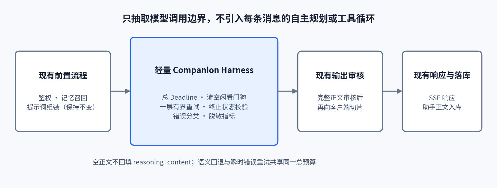

# Amara 轻量 Companion Harness 定向技术调研

**日期：** 2026-11-02  
**范围：** Next.js 14 + TypeScript + Supabase；现有 OpenAI Node SDK 4.104.0，通过 DeepSeek 兼容接口进行聊天补全。只研究模型调用边界，不涉及训练、模型权重、换模型、提示词改写或前端改造。  
**证据标记：** **【官方事实】** 指 DeepSeek、OpenAI SDK 或 Vercel 官方文档/源码；**【现场信号】** 指官方仓库中的用户 issue，不等同于官方确认；**【工程建议】** 与 **【推断】** 不构成服务方承诺。调研执行了 16 个有新增信息的搜索或抓取步骤，未调用生产 API，未读取或记录任何密钥、用户聊天正文。

## 简短结论

Amara 最适合把现有路由中的模型调用抽成一个**单用途、可取消、有总时限的 Companion Harness**，而不是引入每条消息自主规划或工具循环的 Agent。这个 Harness 只需负责四件事：**有界重试、流终止校验、上游错误分类、脱敏可观测性**；记忆召回、提示词、输出安全审核和落库继续保持原有职责与顺序。

最优先的修复点不是增加重试次数，而是统一时间预算。Amara 路由显式设置 `maxDuration = 30`，而 SDK 4.104.0 默认每次请求超时 10 分钟、自动重试 2 次；SDK 的超时计时还会在收到响应头后清除，并不能覆盖后续 SSE 正文停滞。因此必须增加**覆盖所有尝试的总 Deadline**和**流正文空闲看门狗**，否则“多一次重试”只会放大 30 秒平台终止、重复计费和诊断困难。[Vercel 时限说明](https://vercel.com/docs/functions/configuring-functions/duration)；[OpenAI SDK 4.104.0 README](https://github.com/openai/openai-node/blob/v4.104.0/README.md#timeouts)；[SDK 4.104.0 core.ts](https://raw.githubusercontent.com/openai/openai-node/v4.104.0/src/core.ts)。

空正文必须结合 `finish_reason`、`reasoning_content` 是否存在以及 token 用量分类，不能再由单一 `catch` 或单一“空字符串”分支推断原因。**不要把 `reasoning_content` 当正式回答展示或落库。**现有“空正文后关闭思考再试一次”可以保留为最多一次的语义回退，但它必须与瞬时错误重试共享同一个总预算，并且只在终止原因允许时执行。[DeepSeek 思考模式](https://api-docs.deepseek.com/zh-cn/guides/thinking_mode/)；[DeepSeek Chat Completions schema](https://api-docs.deepseek.com/zh-cn/api/create-chat-completion)。

## 1. Amara 当前边界与改造目标

本地代码核对显示，当前路由在模型调用前完成鉴权、记忆召回、提示词和历史组装；首次上游调用使用流式 Chat Completions，聚合 `delta.content`，空正文时以非思考模式再调用一次；随后对完整正文做输出审核，审核通过后才切片写入客户端 SSE 并落库。这意味着当前实现是“**上游流式、应用内聚合、审核后下游切片**”，不是模型 token 直接透传给用户。相关位置为 `app/api/companion/route.ts:354-477`。锁文件确认实际 SDK 为 `openai@4.104.0`，见 `package-lock.json:2698-2701`。

当前代码已经把通用流异常与安全审核结果分开，避免了把 401 直接误报为内容拦截；但通用异常仍统一为 `STREAM_ERROR`，流聚合也没有保存 `finish_reason` 或最终 `usage`。因此下一步应是**收窄并强化模型调用边界**，而不是重写整条聊天链路。对外仍可保持现有 SSE 数据形状和通用用户提示，内部分类与指标不必要求前端同步修改。

| 维度 | 当前实现 | 轻量 Harness 目标 | 明确不做 |
|---|---|---|---|
| 调用方式 | 单次主调用 + 空正文非思考回退 | 同一调用策略，但纳入统一 Deadline 和终止校验 | 每消息规划器、工具选择器、多步 ReAct |
| 流处理 | 聚合正文，审核后切片 | 同时记录终止原因、用量、首块/末块时间和异常阶段 | 未审核正文直接透传 |
| 错误处理 | SDK 默认重试；通用 `STREAM_ERROR` | 一层有界策略；内部按认证、限流、参数、服务端、流中断分类 | 401 自动重试；所有错误都映射成安全拦截 |
| 空正文 | 不看终止原因即非思考回退 | 依据 `finish_reason` 决定是否允许一次回退 | 把推理通道文本补成正式回答 |
| 观测 | 错误名、状态、消息和堆栈 | 白名单结构化字段、阶段耗时、token/cache、回退原因 | 记录密钥、提示词、聊天正文或完整请求/响应 |
| 业务状态 | 审核通过后展示并落库 | 保持展示与落库一致，重试时丢弃旧尝试的部分缓冲 | 拼接不同尝试的正文；重复写入助手消息 |

## 2. 流式响应与终止契约

**【官方事实】** DeepSeek 的 `stream: true` 通过 SSE 发送增量，流以 `data: [DONE]` 结束。无论是否设置 `stream_options.include_usage`，`[DONE]` 前的最后块都携带整次请求的 `usage`；DeepSeek 当前文档明确说明，不会另发一个独立 usage-only 块，统计附着在最后一个不含新增正文、且带非空 `finish_reason` 的 choice 块上。[DeepSeek Chat Completions](https://api-docs.deepseek.com/zh-cn/api/create-chat-completion)。因此 Amara 可以直接在现有逐块循环里收集末块信息，无需另写 SSE 解析器，也不应假定所有 OpenAI 兼容服务都采用完全相同的 usage 块形状。

**【官方事实】** OpenAI Node SDK 4.104.0 的 `Stream` 会忽略 SSE 注释、识别 `[DONE]`，但在底层响应正常 EOF 时同样结束迭代；源码没有要求必须亲眼收到 `[DONE]` 才把迭代视为完成。主动 `stream.controller.abort()` 导致的 `AbortError` 也会平静退出。[SDK 4.104.0 streaming.ts](https://raw.githubusercontent.com/openai/openai-node/v4.104.0/src/streaming.ts)。**【推断】** 所以 `for await` 正常结束本身不是完整性证明。轻量方案无需为追逐 `[DONE]` 而替换 SDK，但至少应要求：**收到可接受的 `finish_reason`、正文非空、没有本地超时/取消标记**，才可进入审核和落库。

建议每次尝试维护一个不包含正文内容的元数据对象：`finishReason`、`usage`、`sawContent`、`sawReasoning`、`completedNormally`、`abortReason`。若发生重试，新建该对象并清空上一尝试的部分正文，避免把两次生成拼接成一个“完整回答”。当前路由只在审核后发送助手正文，心跳不代表内容已提交，因此在发送任何助手正文之前的流中断仍可安全地进行一次有界重试。

## 3. Thinking、空正文与 `finish_reason`

### 3.1 参数语义不能靠 OpenAI 名称猜

**【官方事实】** DeepSeek 当前默认开启思考模式，默认 effort 为 `high`；`reasoning_effort: low/high/max` 都会开启思考，`none` 关闭思考。显式 `thinking.type` 优先于 `reasoning_effort`。思考模式下，`temperature`、`presence_penalty`、`frequency_penalty` 不报错但也不生效；`top_p` 是否生效还取决于模型与模式。[DeepSeek 思考模式](https://api-docs.deepseek.com/zh-cn/guides/thinking_mode/)。这意味着 Amara 首次请求中的 `temperature: 0.7` 不是思考模式下的可靠性或延迟调节杆，也不应通过改它来修复空正文；本报告不建议借 Harness 改造调整该提示生成参数。

**【官方事实】** DeepSeek 文档以 Python 示例说明 `thinking` 通过 `extra_body` 传递；OpenAI Node SDK 4.104.0 则允许未建模的请求参数按原样发送，也允许读取未建模的响应属性，但 TypeScript 类型不会替第三方服务证明支持情况。[OpenAI SDK 自定义参数说明](https://github.com/openai/openai-node/blob/v4.104.0/README.md#making-customundocumented-requests)。**【工程建议】** 若重构现有类型断言，应使用 Node SDK 对应的扩展参数通道并加一个小型契约测试；不要把 Python 的 `extra_body` 写法机械照搬到 Node，也不要把“能发送”理解为“上游一定执行”。

### 3.2 空正文不是单一故障

DeepSeek 把正式回答放在 `content`，思考内容放在同级 `reasoning_content`；无 `tools` 的对话后续轮次无需回传历史 `reasoning_content`，即使回传也会被忽略。[DeepSeek 思考模式](https://api-docs.deepseek.com/zh-cn/guides/thinking_mode/)。官方 schema 还列出 `stop`、`length`、`content_filter`、`tool_calls`、`insufficient_system_resource`、`aborted` 六类终止原因；其中 `length` 表示达到生成或上下文限制，`content_filter` 表示内容被过滤，后两者与认证、网络异常是不同平面的事件。[DeepSeek 响应 schema](https://api-docs.deepseek.com/zh-cn/api/create-chat-completion)。

官方文档明确给出一种“看起来为空但 `finish_reason=stop`”的 JSON Output 情况：非 JSON 内容可能被替换为空格。Amara 当前并未启用 JSON Output，不能拿这个原因解释所有空响应；它证明的是更一般的原则——**HTTP 200、`stop` 与有可见正文不是同义词**。[DeepSeek `response_format` 说明](https://api-docs.deepseek.com/zh-cn/api/create-chat-completion)。此外，DeepSeek 官方 GitHub 仓库的社区 issue 报告过思考开启时只有 `reasoning_content`、正式 `content` 为空且以 `stop` 结束的案例；该 issue 是【现场信号】，不是官方 SLA 或已确认根因，但足以支持记录通道状态并保留防御性空响应处理。[DeepSeek-V3 issue #1673](https://github.com/deepseek-ai/DeepSeek-V3/issues/1673)。

| 流结局 | 证据含义 | 【工程建议】Amara 处理 |
|---|---|---|
| 正文非空 + `stop` | 正常候选结果 | 进入现有输出审核；审核通过后才展示、落库 |
| 正文非空 + `length` | 输出被截断，不能视作完整正常结束 | 默认不静默接受为完整回答；记录截断，按既定用户失败语义结束，不在本轮引入自动续写循环 |
| 正文为空/纯空白 + `length` | 可能只有推理或预算耗尽 | 若剩余预算充足，允许最多一次 `thinking: disabled` 回退；否则返回现有 `EMPTY_MODEL_RESPONSE` |
| 正文为空/纯空白 + `stop` | 正常终止信号但没有可展示正文 | 记录 `sawReasoning` 与 token 用量；允许同一一次非思考回退，不回填推理文本 |
| 任意正文 + `content_filter` | 上游内容过滤，不是 401/网络故障 | 不重试；内部记为 `UPSTREAM_CONTENT_FILTER`，对外沿用安全类语义 |
| `insufficient_system_resource` / `aborted` | HTTP 成功流中的上游中断或资源不足 | 在尚未展示/落库时，最多一次瞬时错误重试；不与非思考回退无限交替 |
| `tool_calls` | 当前无工具聊天契约的意外结果 | 不执行工具、不进入 Agent 循环；记录契约异常并失败关闭 |
| 无终止原因、流异常或本地看门狗触发 | 完整性未知 | 丢弃本次部分缓冲；仅在总预算允许时重试一次 |

## 4. 错误分类、重试与指数退避

### 4.1 HTTP 与 SDK 异常必须分层

**【官方事实】** DeepSeek 将 400 定义为请求体格式错误、401 为认证失败、402 为余额不足、422 为参数错误、429 为速率或并发达到上限；500 建议等待后重试，503 建议稍后重试。[DeepSeek 错误码](https://api-docs.deepseek.com/zh-cn/quick_start/error_codes)。SDK 4.104.0 另外把连接错误、408、409、429 和大于等于 500 的状态列入默认自动重试范围，并提供 `AuthenticationError`、`RateLimitError`、`InternalServerError`、`APIConnectionError` 等类型。[SDK 4.104.0 错误与重试](https://github.com/openai/openai-node/blob/v4.104.0/README.md#handling-errors)。

**【工程建议】** 内部分类不应只依赖 `err.message`，而应优先使用 SDK 错误类型、HTTP `status`、流终止原因和本地取消原因。对用户仍返回既有的克制提示；对运维告警则保留可检索类别。401 应立即触发配置告警且不重试，402 表示上游账户余额问题而不是 Amara 用户额度，429 需要退避而不是立即密集重试。原始错误消息和堆栈可能夹带 URL 或请求细节，生产日志宜改为字段白名单，而不是无条件完整输出。

| 类别 | 典型信号 | 默认重试 | 内部诊断方向 |
|---|---|---:|---|
| 上游认证 | 401 / `AuthenticationError` | **否** | `UPSTREAM_AUTH_ERROR`；检查密钥配置与轮换，告警但不暴露值 |
| 上游计费 | 402 | **否** | `UPSTREAM_BILLING_ERROR`；不要与 Amara 自身 402 额度响应混淆 |
| 请求契约 | 400、404、422 | **否** | 模型名、消息结构、扩展参数或接口路径契约 |
| 权限 | 403 | **否** | 账户/接口权限；不是内容安全结论 |
| 限流/并发 | 429 / `RateLimitError` | **最多一次且受预算约束** | 尊重合理的 `Retry-After`，记录退避时长与尝试序号 |
| 服务端 | 500、503、其他 5xx | **最多一次且受预算约束** | 指数退避 + 抖动；持续失败时结合官方状态页排查 |
| 请求超时/连接 | 408、`APIConnectionTimeoutError`、`APIConnectionError` | **最多一次且受预算约束** | 区分建连/响应头超时与正文流中断 |
| 冲突 | 409 | 默认不新增外层重试 | SDK 会自动重试，但 DeepSeek 错误表未给出其业务语义，先观测 |
| 流中逻辑失败 | `insufficient_system_resource`、`aborted`、无终止 EOF | **最多一次且受预算约束** | 无 HTTP 状态也要独立计数，不能归入安全拦截 |

### 4.2 只保留一层重试，所有尝试共享预算

SDK 4.104.0 默认重试 2 次，使用短指数退避；源码给出初始 0.5 秒、上限 8 秒、最多 25% 的随机抖动，并优先采用合法的 `retry-after-ms` 或 `Retry-After`，但只直接接受小于 60 秒的等待值。[SDK 4.104.0 core.ts](https://raw.githubusercontent.com/openai/openai-node/v4.104.0/src/core.ts)。这套默认机制是通用 SDK 行为，并不知道 Amara 只有 30 秒，也不知道后面还要执行安全审核和 Supabase 写入。

**【工程建议】** 为便于审计和避免嵌套重试，建议 Harness 将 SDK `maxRetries` 设为 0，由 Harness 对连接/408/429/5xx/流中断实施**最多一次**同类重试；这样每次尝试、退避和剩余预算都有明确指标。如果优先追求最少代码，也可使用 SDK `maxRetries: 1`，但不得再叠加外层通用重试，并接受其逐尝试观测较弱。两种方案只能选一种；空正文的非思考回退是另一种语义策略，同样全局限一次，不能与瞬时重试形成多轮交替。

重试前应重新计算剩余时间。若 `Retry-After` 或一次新尝试的最低预算已经超过 Deadline，应立即失败并提示稍后重试，而不是睡眠到平台终止。DeepSeek 文档没有在本调研所核对页面中承诺 Chat Completions 的应用级幂等重放，因此不要假定重复请求不会产生额外 token 费用；缓存命中也不等于免费或结果复用。

## 5. 请求超时预算与取消

**【官方事实】** Vercel 的 `maxDuration` 是函数被终止前可运行的最长时间，官方明确把流式响应等待也包含在内；HTTP/1.1 空闲连接可用心跳维持，但心跳不会改变函数最大运行时限。[Vercel duration](https://vercel.com/docs/functions/configuring-functions/duration)。DeepSeek 在请求排队期间可发送空行或 `: keep-alive`，若 10 分钟后仍未开始推理会关闭连接；保活只证明传输层仍有活动，不代表正文正在生成。[DeepSeek 限速与保活](https://api-docs.deepseek.com/zh-cn/quick_start/rate_limit)。

**【官方事实】** SDK 4.104.0 默认 `timeout = 600000`，其 `fetchWithTimeout` 在 fetch Promise 完成后清除计时器；对流式请求而言，fetch 在响应头到达后即可完成，后续正文读取由 `Stream` 处理。[SDK 4.104.0 core.ts](https://raw.githubusercontent.com/openai/openai-node/v4.104.0/src/core.ts)、[streaming.ts](https://raw.githubusercontent.com/openai/openai-node/v4.104.0/src/streaming.ts)。**【推断】** 仅设置 SDK `timeout` 不能替代整条流的总 Deadline 或正文空闲看门狗，这是 Amara 超时设计中最容易漏掉的边界。

以下数值是**【工程建议】起始值，不是 DeepSeek 官方推荐或 SLA**，应在不记录正文的前提下用生产耗时分布校准：

| 预算项 | 建议起始值 | 约束 |
|---|---:|---|
| 路由硬上限 | 现有 30 秒 | 本次不要求调整部署配置 |
| 模型调用总 Deadline | **22–24 秒** | 覆盖主调用、退避、唯一瞬时重试和唯一非思考回退 |
| 响应头/首块等待 | 8–10 秒 | 超时后仅在剩余预算足够时重试 |
| 相邻解析块空闲 | 8–12 秒 | 看的是模型流进展，不把本地心跳当模型正文 |
| 审核、落库和网络余量 | 预留 6–8 秒 | 根据 `reviewContentSafety` 与 Supabase 实测占比校准 |

总预算可表达为：`T_model_total <= 30s - T_output_review - T_db_and_response_margin`。如果主调用已消耗过多预算，应跳过非思考回退并返回现有空响应/暂时失败语义，而不是给它一个新的 20 秒窗口。客户端断开或路由取消时，应调用上游 `stream.controller.abort()` 并标记本地取消原因，避免继续消耗生成 token；由于 SDK 主动 abort 会平静结束，本地必须保存 `abortReason`，防止把取消误判为完整空响应。

## 6. 上下文缓存与可观测性

### 6.1 缓存只观测，不在本轮重构提示词

**【官方事实】** DeepSeek 上下文硬盘缓存默认开启，按先前已落盘的**完整前缀单元**匹配，不是语义相似缓存；命中是尽力而为，缓存会在不再使用后自动清理。响应的 `usage.prompt_cache_hit_tokens` 与 `prompt_cache_miss_tokens` 可用于观测，缓存不改变输出随机性。[DeepSeek 上下文硬盘缓存](https://api-docs.deepseek.com/zh-cn/guides/kv_cache)。因此 Harness 不需要实现手工 KV cache，也不能把某次命中当成必然延迟保证。

本轮明确不改提示词，所以不建议为了缓存而重排 system、时间锚点、记忆或历史消息。可先从流末块收集缓存命中/未命中 token，观察现状；若未来要优化前缀稳定性，应作为独立提示词变更评审，而非夹带在可靠性 Harness 中。DeepSeek 的可选 `user_id` 同时涉及内容安全、KVCache 和调度隔离，官方要求不要放入隐私信息；本轮没有必要为缓存新增该字段，更不能直接记录原始用户标识。[DeepSeek `user_id` 说明](https://api-docs.deepseek.com/zh-cn/quick_start/rate_limit)。

### 6.2 指标要回答“失败在哪一段”

建议每次模型尝试产生一条结构化结果，字段只包含元数据。指标既要覆盖 HTTP 失败，也要覆盖 HTTP 200 后的空正文、截断、流中断和取消。DeepSeek 官方服务状态页可用于区分账户/代码问题与提供方事件，但状态页不能替代请求级指标。[DeepSeek 服务状态](https://status.deepseek.com/)。

| 观测组 | 建议字段 | 用途 |
|---|---|---|
| 关联与版本 | 内部 `request_id`、模型名、base URL 主机、SDK 版本、attempt | 关联一次用户请求内的多次尝试；不记录 URL 查询或凭据 |
| 阶段耗时 | recall、create-to-headers、首个 content delta、末块、输出审核、落库、总耗时 | 区分记忆慢、首字节慢、生成慢、审核慢和数据库慢 |
| 流完整性 | `finish_reason`、`sawContent`、`sawReasoning`、`completedNormally`、`abortReason` | 识别空正文、截断、无终止 EOF 和本地看门狗 |
| 错误分类 | SDK `name`、HTTP `status`、稳定 `code`、重试原因、退避毫秒 | 让 401、429、5xx、安全过滤和流中断可分别告警 |
| 用量与缓存 | prompt/completion/total/reasoning tokens、cache hit/miss tokens | 成本、推理耗尽和缓存趋势；usage 缺失记为 unknown，不填 0 |
| 结果 | success、empty、truncated、blocked、failed、fallback_used、persisted | 计算真实成功率和回退收益，避免只统计 HTTP 200 |

SDK 4.104.0 支持从 `x-request-id` 提取请求 ID，流式调用也可用 `.withResponse()` 取得响应元数据；但**【推断】**不应假定 DeepSeek 每个响应都一定提供该头，缺失时保持空值。[SDK 4.104.0 Request IDs](https://github.com/openai/openai-node/blob/v4.104.0/README.md#request-ids)。不要在生产启用该版本的全局 `DEBUG=true` 作为常规观测方案：其版本化 README 明确说会记录请求和响应，脱敏重点是认证头，并不等于对聊天正文做全面脱敏。[SDK 4.104.0 Logging](https://github.com/openai/openai-node/blob/v4.104.0/README.md#logging-and-middleware)。

## 7. 不能假定第三方兼容服务支持的参数与行为

DeepSeek 官方表述是使用与 OpenAI/Anthropic **兼容的 API 格式**，并允许通过 SDK 访问；这证明传输和基本 schema 可复用，不证明所有 OpenAI 参数、扩展字段、默认值和错误语义逐字通用。[DeepSeek 快速开始](https://api-docs.deepseek.com/zh-cn/)。OpenAI SDK 对未知参数通常按原样发送、对未知响应属性不自动剥离，也不做第三方服务能力验证。[OpenAI SDK 自定义参数](https://github.com/openai/openai-node/blob/v4.104.0/README.md#making-customundocumented-requests)。

| 参数/行为 | 已核实的 DeepSeek 当前事实 | 兼容服务不能假定的事项 |
|---|---|---|
| `thinking` / `reasoning_effort` | DeepSeek 有明确开关、优先级和 effort 映射 | 其他服务未必支持相同对象、枚举、默认值或优先级 |
| `reasoning_content` | DeepSeek 思考通道与正式 `content` 分离 | 字段名、流位置、是否回传及是否持久化不能通用化 |
| `temperature` / `top_p` / penalties | 思考模式下部分被忽略，`top_p` 依模型/模式变化 | “请求未报错”不代表参数实际生效 |
| `stream_options.include_usage` | DeepSeek 最后内容块携带 usage，无独立 usage-only 块 | 其他服务可能采用不同末块或空 `choices` 形式 |
| `finish_reason` | DeepSeek 有六个文档化枚举 | 不应假定所有服务都实现同一扩展枚举或相同含义 |
| `response_format` / strict tools | DeepSeek 有各自约束与 Beta 语义 | JSON 保证、strict schema、工具选择模式不可默认可移植 |
| `logprobs` / `top_logprobs` | 当前 DeepSeek schema 有定义 | 第三方兼容端点可能忽略、拒绝或返回不同结构 |
| `user_id` | DeepSeek 用于安全、缓存和调度隔离 | OpenAI 的 `user` 或其他服务字段不能自动替代 |
| cache usage 字段 | DeepSeek 返回 hit/miss tokens | 命中保证、缓存寿命、隔离和字段存在性不可假定 |
| `Retry-After` / `x-should-retry` | SDK 有通用处理规则 | DeepSeek 是否总是返回这些头未获本调研证据支持 |
| 幂等键/安全重放 | 本次核对的 DeepSeek Chat 文档未作应用级承诺 | 不应假设所有兼容服务去重、免费重试或返回同一结果 |

## 8. 采用 / 不采用清单

### 采用（按优先级）

- **P0 — 抽取单一模型调用 Harness：** 输入已组装好的 messages 和固定调用参数，输出正文及元数据；不接管记忆、提示词、安全审核或数据库。
- **P0 — 一个总 Deadline：** 22–24 秒作为待观测校准的起始值，所有尝试共享；为审核、落库和响应预留 6–8 秒。
- **P0 — 流看门狗与取消传播：** 区分响应头等待、正文块空闲和本地主动取消；客户端断开时终止上游。
- **P0 — 显式终止校验：** 聚合 `content` 的同时保存 `finish_reason` 和 `usage`；不能只凭 `for await` 结束判成功。
- **P0 — 内部错误分类：** 401/402/400/422/429/5xx/连接/流中断/过滤分别计数；401 不重试并告警，对外不暴露配置细节。
- **P0 — 一层有界重试：** 推荐 SDK `maxRetries: 0` + Harness 唯一一次瞬时重试；空正文非思考回退最多一次，不与瞬时重试交替成循环。
- **P0 — 脱敏结构化日志：** 只记录白名单元数据、长度、布尔标志、token 和耗时，不记录密钥、提示词、消息正文或完整错误负载。
- **P1 — 缓存与成本观测：** 收集 cache hit/miss、reasoning/completion tokens；不在本轮改提示词追求命中。
- **P1 — 契约回归测试：** 用伪造流覆盖 401、429、5xx、空正文 + `stop`、空正文 + `length`、无终止 EOF、流停滞和取消，不需要真实密钥或用户内容。

### 不采用（本轮明确排除）

- 不引入自主规划、工具调用、多步 Agent、自动续写或无限“直到成功”循环。
- 不更换模型、不重写提示词、不改变前端 SSE 契约，不把上游 `reasoning_content` 展示或落库。
- 不给每次重试和回退重新发放完整时间预算，不在 401、402、参数错误或 `content_filter` 上盲目重试。
- 不把 SDK 默认 10 分钟超时当作流总时限，不把心跳当生成成功，也不把 HTTP 200 当业务成功。
- 不自建 DeepSeek KV cache，不承诺缓存必中，不为缓存在本轮重排提示词。
- 不根据“OpenAI 兼容”推断扩展参数、usage、幂等键或错误头必然受支持。
- 不在生产长期使用 SDK 4.104.0 的全量 DEBUG 请求/响应日志，不在日志中保存原始聊天或密钥。

## 9. 最小验收矩阵

| 场景 | 必须观察到的 Harness 行为 |
|---|---|
| 上游 401 | 0 次重试；内部认证告警；对外通用失败；不出现安全拦截误报或敏感配置 |
| 429 且 `Retry-After` 超出剩余预算 | 不睡眠等待；快速失败并记录限流与剩余预算 |
| 500 后一次成功 | 只有一次退避重试；两次 attempt 指标可关联；不重复写入助手消息 |
| 空正文 + `length` | 记录终止原因和 reasoning/token 元数据；预算足够时只回退一次非思考 |
| 空正文 + `stop` | 不把推理文本当回答；最多一次回退；仍为空则走现有 `EMPTY_MODEL_RESPONSE` |
| 正文非空 + `length` | 标记截断，不按完整 `stop` 结果静默落库 |
| `content_filter` | 不重试；内部与 401/网络错误分开；对外保持安全语义 |
| 收到部分块后停滞 | 看门狗取消；丢弃部分缓冲；总预算允许才重试；不得拼接旧正文 |
| 正常 EOF 但无 `finish_reason` | 不判完整成功；记为流完整性失败 |
| 客户端断开 | 上游 abort；记录本地取消；不审核、不落库未完成正文 |
| 正常完成 | 先审核再切片与落库；记录 usage/cache；日志无任何聊天正文或密钥 |

## 10. 证据边界

本报告只陈述 2026-11-02 当日实际抓取到的官方文档与版本化源码，不把旧版 DeepSeek 行为或其他兼容服务行为投射为当前功能。官方 GitHub issue 仅用于证明防御性处理的现实必要性，其中发生率、特定请求条件和用户自述耗时没有被当作 DeepSeek 官方统计或 Amara 预期值。建议的秒数、重试次数和内部错误名均为工程起点，最终应由 Amara 的脱敏生产指标校准；本次未对生产接口发起测试，也未验证任何密钥状态。
